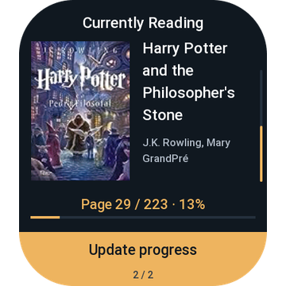
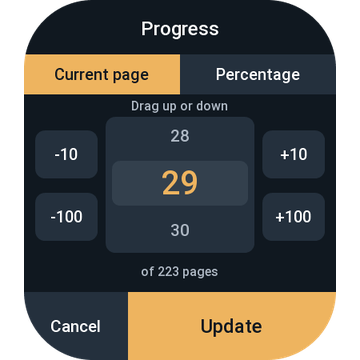
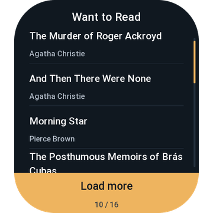
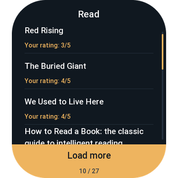
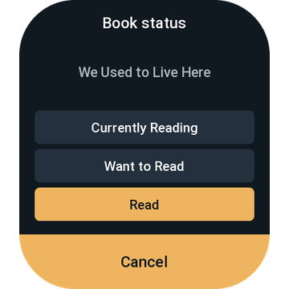

# Zepp OS Hardcover

Browse your [Hardcover](https://hardcover.app/) library and update your reading progress from a Zepp OS watch. The app is free, with no in-app purchases.

Currently Reading comes first, with a cover, title, and progress. Swipe up and down to move between those books. Swipe sideways for Want to Read and Read. Those lists do not download covers. Read shows your rating when you have one.

Update progress by absolute current page or percentage. The value is the page you are on, not pages read in a session. Tap a cover or a list title to move a book between Currently Reading, Want to Read, and Read. Saving does not automatically finish a book or create a new reading record.

The Zepp app on your paired phone connects to Hardcover, holds your token, downloads covers, and sends updates. The watch receives book data and local cover files. Cached books remain available offline; synchronization needs your phone and an internet connection.

This is not an official Hardcover or Zepp Health product.

## Bip 6 screenshots

Screenshots from the Amazfit Bip 6 show the library, progress editor, and reading status controls.

| Currently Reading | Update progress | Want to Read |
| --- | --- | --- |
|  |  |  |

| Read | Book status |
| --- | --- |
|  |  |

## Watch compatibility

The 0.6.9 package prepared for Zepp store review includes the following rectangular-screen devices. Bip 6 is the device used for testing with Zepp on iPhone. The other devices passed a review of the scaled layout; they have not been tested on hardware.

| Watch | Screen resolution | Validation |
| --- | --- | --- |
| Amazfit Bip 6 | 390×450 | On-watch testing with Zepp on iPhone |
| Amazfit Active 2 Square, including NFC | 390×450 | Layout reviewed |
| Amazfit Active | 390×450 | Layout reviewed |
| Amazfit GTS 4 | 390×450 | Layout reviewed |
| Amazfit Cheetah Square | 390×450 | Layout reviewed |
| Amazfit Bip 5 Unity and Bip 5 Core | 320×380 | Layout reviewed |
| Amazfit Bip Max | 432×514 | Layout reviewed |

The release package requires API level 3.0 or later. Round watches are excluded because the current layout clips list titles and footer controls. Bip 5, GTR Mini, T-Rex 2, GTS 4 mini, and Band 7 are excluded by the API requirement. Very long titles can be cut off on the reading screen, including on Bip 6.

## Connect Hardcover

Create a personal API token and paste it into the miniapp settings in Zepp. Do not enable the `all` permission.

Required permissions:

- `read:me:content`
- `read:library:public`
- `read:library:private`
- `read:catalog:data`
- `write:library`

The settings screen links to the Hardcover form with those permissions selected: [Create a Hardcover token](https://hardcover.app/account/api/keys/new?scope=read:me:content+read:library:public+read:library:private+read:catalog:data+write:library). Copy the token when Hardcover shows it. It is shown only once.

The token stays in Zepp settings storage on the phone. That storage is not an OS keychain. Do not commit the token or share a screenshot that contains it.

## Install with developer mode

The current package is installed through Zepp developer mode. A Zepp store listing is not yet available.

1. Install Zepp on your phone, sign in, and pair the watch.
2. Turn on developer mode. Open Profile, Settings, About, and tap the Zepp icon seven times until the prompt appears.
3. In this project, install dependencies and start a preview:

```sh
npm ci
npm run zeus -- preview
```

4. When the terminal shows a QR code, open Profile, go to the paired device page, scroll to the bottom, and open Developer Mode.
5. Tap Scan and scan the QR code. Keep the phone near the watch and leave Bluetooth connected.
6. Open Hardcover on the watch. In Zepp, open the miniapp settings, create the token, paste it, and save.

If installation reports that the Bluetooth channel is unavailable or DFU is busy, wait a moment and scan again.

Developer mode can also take a watch screenshot and collect device logs. Settings-page logs are not available in that viewer. To turn developer mode off, remove it from Profile, Settings.

Official steps: [Zepp developer mode](https://docs.zepp.com/docs/guides/tools/zepp-app/) and [preview on a watch](https://docs.zepp.com/docs/guides/quick-start/preview/).

## Development

```sh
npm test
npm run build
```

Tests use simulated Zepp responses. They do not replace trying the app on a paired watch. The screenshots shown above are in `docs/store/submission/`.

This app is registered with Zepp as `1131166`. For your own distribution, set your registered app ID in `app.json`. Public distribution should use OAuth instead of asking people to paste a personal token. See [publishing notes](docs/publishing.md).

## References

- [Zepp OS documentation](https://docs.zepp.com/)
- [Zepp device specifications](https://docs.zepp.com/docs/reference/related-resources/device-list/)
- [Hardcover API](https://docs.hardcover.app/api/getting-started/)
